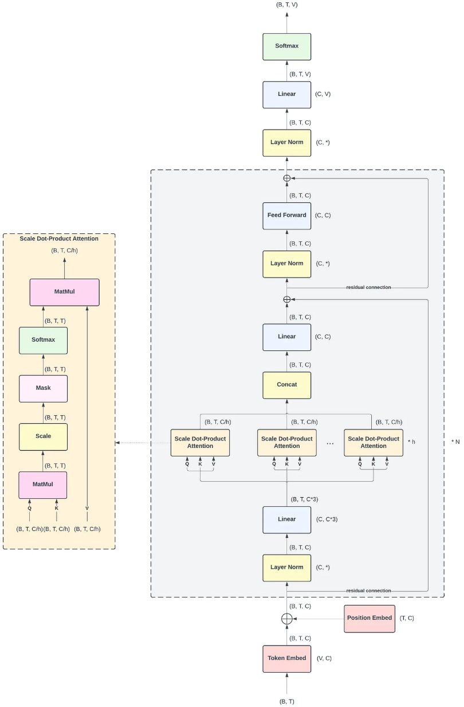

# 大作业1：从零开始搭建一个小型LLM模型

## 零、交我算服务器的使用

使用手册：https://docs.hpc.sjtu.edu.cn/index.html

**请优先使用 π 2.0 集群完成作业。** 学生账号只能在校内使用。登录节点为 `pilogin`（`pilogin.hpc.sjtu.edu.cn`）。

**请务必不要在登录节点上运行作业，否则账号将会被封禁。** 登录节点只用来传文件、改脚本和 `sbatch`。训练、下载大文件、`pip install` 都要提交到计算队列，不能在 `pilogin` 上直接执行。

- CPU 作业（安装环境、训练分词器）使用 `cpu` 队列。
- GPU 作业（训练模型）使用 `dgx2` 队列。单卡显存 32GB。每人同时只保留一个 GPU 作业，脚本里写 `--gres=gpu:1`、`--cpus-per-task=6`。
- 目前集群 GPU 资源紧张，提交后可能会排队。请尽早开始，先在 `cpu` 队列把环境和分词器准备好，再按第 0.6 节估算墙钟时间、安排提交，并在训练脚本里定期保存检查点。

`dgx2` 上的卡是 NVIDIA Tesla V100，计算能力 sm_70，只用 float16。混合精度的写法见第 3.4 节。

### 0.1 登录

在校内网络下登录。

```bash
ssh 你的账号@pilogin.hpc.sjtu.edu.cn
```

### 0.2 上传代码和数据

传文件在自己的电脑上执行：

```bash
scp -r 你的作业目录 你的账号@pilogin.hpc.sjtu.edu.cn:目标目录
scp TinyStories-train.txt TinyStories-valid.txt 你的账号@pilogin.hpc.sjtu.edu.cn:目标目录/data/
```

`scp` 报 `Connection timed out` 时，换传输节点 `data.hpc.sjtu.edu.cn`。大批量数据优先走传输节点。

### 0.3 确认队列

登录后先看队列，分区名以命令输出为准：

```bash
sinfo -p dgx2
sinfo -p cpu
module avail miniconda3
```

手册写明：推荐每张 V100 配 6 个 CPU 核，每个核 15GB 内存；本次作业按这个配比申请其中 1 张。

训练脚本申请最长 12 小时。需要延长已经在跑的作业时，提前一个工作日邮件 hpc@sjtu.edu.cn，写明用户名和作业号。

目前集群 GPU 资源紧张，`squeue` 里长时间显示 `PD` 是正常现象。请把环境安装和分词器训练提前放到 `cpu` 队列做完，GPU 作业尽早提交，并周期性保存检查点。`STATE` 全是 `drain`、`down` 或 `drain*` 时，这张队列当前没有空闲机器，已提交的 GPU 作业会继续排队，节点恢复后调度器会把它拉起来。

加载 Conda：

```bash
module load miniconda3
```

### 0.4 环境安装

在 `cpu` 队列里配环境。先申请节点，再在这个节点上依次执行后面的命令。登录节点上不要执行这些 `pip`。

```bash
srun -p cpu -n 4 --time=02:00:00 --pty bash
```

```bash
module load miniconda3
conda create -n llm python=3.11 -y
source activate llm
export http_proxy=http://proxy.pi.sjtu.edu.cn:3004/
export https_proxy=http://proxy.pi.sjtu.edu.cn:3004/
export no_proxy=puppet
python -m pip install -U pip
python -m pip install numpy regex tokenizers
python -m pip install torch==2.14.0 --index-url https://download.pytorch.org/whl/cu126
python -c "import torch; print(torch.__version__, torch.version.cuda); print(torch.cuda.get_arch_list())"
exit
```

第 0.6 节短作业若报 `CUDA driver version is insufficient`，看日志里 `nvidia-smi` 右上角的 `CUDA Version`，回到这个 `cpu` 节点，按版本只执行一行，然后再跑上面的 `python -c`。

驱动显示 12.1 到 12.5：

```bash
python -m pip install torch==2.5.1 --index-url https://download.pytorch.org/whl/cu121
```

驱动显示 11.x：

```bash
python -m pip install torch==2.5.1 --index-url https://download.pytorch.org/whl/cu118
```

### 0.5 在 CPU 队列训练分词器

BPE 分词器在 CPU 上训练。进入作业目录后，再开一个 CPU 交互作业，按第 4.5 节的代码读 `data/TinyStories-train.txt`，把 `tokenizer.json` 写到作业目录里，然后 `exit`。

```bash
cd ~/llm
srun -p cpu -n 4 --time=02:00:00 --pty bash
module load miniconda3
source activate llm
python train_tokenizer.py
exit
```

`train_tokenizer.py` 换成你自己的脚本。这一步结束时，`tokenizer.get_vocab_size()` 要和第 4.4 节 `config.json` 里的 `vocab_size` 一致。

### 0.6 提交训练

在登录节点上，把下面的内容存成 `~/llm/train.slurm`。最后一行换成你自己的训练入口。训练脚本使用第 3.4 节的 float16，并按固定步数把检查点写到家目录下的作业目录。时限到达后作业会被结束，再用同一份检查点提交一次即可继续。

```bash
#!/bin/bash
#SBATCH --job-name=llm-train
#SBATCH --partition=dgx2
#SBATCH --nodes=1
#SBATCH --ntasks-per-node=1
#SBATCH --cpus-per-task=6
#SBATCH --gres=gpu:1
#SBATCH --time=12:00:00
#SBATCH --output=hpc-train-%j.out
#SBATCH --error=hpc-train-%j.err

set -euo pipefail
cd "${SLURM_SUBMIT_DIR}"

module load miniconda3
source activate llm

nvidia-smi
export PYTHONUNBUFFERED=1
export OMP_NUM_THREADS=6

python - << 'PY'
import torch
count = torch.cuda.device_count()
if count != 1:
    raise SystemExit(f"看到 {count} 张 GPU，本次作业只用 1 张")
name = torch.cuda.get_device_name(0)
print(name, torch.cuda.get_device_capability(0))
PY

python template.py
```

先把步数改小，做一次短作业。日志里应有 `V100`，loss 应为有限数值。短作业用同一份脚本，提交时覆盖时限：

```bash
cd ~/llm
sbatch --time=00:30:00 train.slurm
squeue -u "$USER"
tail -f hpc-train-作业号.out
```

`dgx2` 全是 `drain` 时也可以先 `sbatch`。作业会停在 `PD`，这段时间不占 `--time`，节点恢复后调度器会把它拉起来。想在开始和结束时收信：

```bash
sbatch --mail-type=BEGIN,END,FAIL --mail-user=你的邮箱 train.slurm
```

同时只保留一个 `dgx2` 作业。短作业还在排队或运行时，等它结束再提交正式脚本。目前 GPU 资源紧张，排队可能要比较久，请把提交时间留出余量。几天后仍然是 `PD`，把用户名、作业号和 `sinfo -p dgx2` 的输出寄到 hpc@sjtu.edu.cn。

正式训练：

```bash
sbatch train.slurm
```

正式开跑前，用一小段数据估每步耗时，再按故事条数和 epoch 换算总时间。第二节里的笔记本耗时只作数量级参考。`--time` 写在 `sinfo` 给出的上限之内。一次作业跑不完时，从最近的检查点再 `sbatch` 一次。

查看和取消：

```bash
squeue -u "$USER"
scancel 作业号
```

作业开始后，`squeue` 里会出现节点名。先登录该计算节点，再执行 `nvidia-smi` 看利用率。显存落在这一张卡上。利用率长期为 0 时，先看 `hpc-train-作业号.err`。常见原因是环境没激活，或 PyTorch 和驱动不匹配。

### 0.7 把结果取回来

作业结束后，在自己的电脑上取回提交需要的文件：

```bash
scp 你的账号@pilogin.hpc.sjtu.edu.cn:~/llm/best.pt .
scp 你的账号@pilogin.hpc.sjtu.edu.cn:~/llm/config.json .
scp 你的账号@pilogin.hpc.sjtu.edu.cn:~/llm/tokenizer.json .
scp 你的账号@pilogin.hpc.sjtu.edu.cn:~/llm/model.py .
```

打包前在本地用第 4.9 节的 `eval_bpb.py` 自测一遍。

---

## 一、任务概述

本次大作业要求你**从零搭建并训练**一个小型大语言模型，参数量约 **50M–120M**，使其能够在 **TinyStories** 数据集上生成语法正确、语义连贯的英文短篇故事。

**本次作业不限制你使用任何 PyTorch API**。你可以使用 `torch.nn.Linear`、`nn.Embedding`、`nn.LayerNorm`、`nn.MultiheadAttention` 等任何你熟悉的模块，也可以用 `nn.Parameter` 从零手写。我们只要求你：

1. 完整理解并实现LLM的核心结构；
2. 跑通完整的训练流程（数据处理 → 模型 → 训练 → 生成）；
3. 训练出一个能在固定测试集上取得合理指标的模型；
4. 提交可复现的源码、模型检查点和一份分析报告。

我们提供了一份**框架模板** `model_template.py`，模板提供了一个 GPT-2 风格的 decoder-only Transformer 语言模型框架，其中只包含必要的类名和函数名，函数体用伪代码提示，你需要自己补全。

---

## 二、数据集

**TinyStories**（https://huggingface.co/datasets/roneneldan/TinyStories）

- 规模：约 211 万条英文短篇故事
- 特点：词汇简单、语法基础，专为小模型语言学习设计
- 训练集：`data/TinyStories-train.txt`（约 1.9 GB）
- 验证/测试：由助教提供固定测试集（不公开，评测时使用，数据集中的`TinyStories-valid.txt`可用于自行验证，但不作为最终评测标准）

**注意事项**：

- 训练集和测试集不同源。评测集为助教私有，学生无法获取，也无法用于训练。
- 你可以使用完整训练集或自行取子集，但需在报告中说明。
- 取用的数据集大小和训练轮次会影响训练用时，为避免训练用时过长，进行完整的训练前需要估计好时间。（以下信息供参考：使用5070Ti laptap和800000条数据训练一个epoch大约需要3小时，在TinyStories-valid上的loss为1.6左右，BPB为0.56左右）

---

## 三、技术规格（供参考）

### 3.1 模型结构

下图是模板对应的GPT-2的模型结构，供参考学习：



推荐配置（也是我们提供的模板配置）：


| 超参数       | 推荐值                | 说明                  |
| ------------ | --------------------- | --------------------- |
| `block_size` | 512                   | 最大上下文长度        |
| `n_layer`    | 6                     | Transformer 层数      |
| `n_head`     | 12                    | 注意力头数            |
| `n_embd`     | 768                   | 嵌入维度              |
| `vocab_size` | 由你的 BPE 分词器决定 | 建议 8192–50257      |
| 参数量       | ~120M                 | 在上述配置下约为 120M |

你可以调整上述超参数，但需保证参数量在 **50M–150M** 之间，并在报告中说明调整理由。

### 3.2 需要实现的组件

- **BPE 分词器**的训练与编码
- **因果自注意力**（`CausalSelfAttention`），必须自己处理因果掩码
- **多头注意力**（`MultiHeadAttention`），多头拼接和输出投影
- **前馈网络**（`FeedForward`），建议 GELU
- **Transformer Block**（`Block`），pre-norm 结构：`x = x + attn(ln(x))`，`x = x + ffn(ln(x))`
- **GPT 主类**（`GPT`），token embedding + position embedding + blocks + ln_final + lm_head
- **训练循环**（`train`），前向、反向、优化器更新
- **评估函数**（`evaluate`），在验证集上计算 loss 和 BPB
- **生成函数**（`generate`），greedy decoding

### 3.3 固定随机种子

你的代码中必须包含以下种子设置：

```python
import random, numpy as np, torch
random.seed(42)
np.random.seed(42)
torch.manual_seed(42)
torch.cuda.manual_seed_all(42)
torch.backends.cudnn.deterministic = True
torch.backends.cudnn.benchmark = False
```

### 3.4 V100 特别注意事项

V100 不支持 bfloat16，只能用 **float16（FP16）**。建议使用 `torch.cuda.amp`：

```python
from torch.cuda.amp import autocast, GradScaler

scaler = GradScaler(init_scale=2**14)

with autocast(dtype=torch.float16):
    logits, loss = model(x, targets=y)
optimizer.zero_grad()
scaler.scale(loss).backward()
scaler.unscale_(optimizer)
torch.nn.utils.clip_grad_norm_(model.parameters(), 1.0)
scaler.step(optimizer)
scaler.update()
```

如果在训练中遇到 loss 变成 NaN，通常是 FP16 数值溢出，请：

- 降低初始 loss scale（如 2^14）；
- 减小学习率；
- 加入梯度裁剪（`clip_grad_norm_`）。

可以在报告中记录你遇到并解决数值不稳定问题的过程。

---


## 四、提交材料

### 4.1 提交方式

每位同学需要提交**一个**压缩包：

```
学号.tar.gz
```

例如学号是 `524030912345`，则文件名是 `524030912345.tar.gz`。

**压缩包内部的文件名必须统一为英文**，方便助教批量评测。请严格按下面的目录结构组织：

```
学号/                       ← 压缩包解压后的顶层目录（用你的学号命名）
├── model.py                ← 模型定义，必须暴露 GPT 类
├── config.json             ← 模型配置
├── tokenizer.json          ← 你自己训练的 BPE 分词器
├── best.pt                 ← 最佳模型检查点
└── report.pdf              ← 分析报告
```

**不要在压缩包里放数据集**（如 `TinyStories-train.txt`），也不要放 `__pycache__`、`.DS_Store`、`.ipynb_checkpoints` 等临时文件。

### 4.2 各文件说明


| 文件             | 内容                                      | 说明                   |
| ---------------- | ----------------------------------------- | ---------------------- |
| `model.py`       | 模型定义，必须暴露`GPT` 类                | 评测脚本动态导入       |
| `config.json`    | 模型配置，字段与`GPT.__init__` 的参数一致 | 评测脚本用它构造模型   |
| `tokenizer.json` | 你自己训练的 BPE 分词器                   | 评测脚本用它编码评测集 |
| `best.pt`        | 最佳验证 loss 的模型权重                  | 评测脚本加载它         |
| `report.pdf`     | 分析报告                                  | 人工评分               |

### 4.3 `model.py`

**必须暴露一个名为 `GPT` 的类**，评测脚本会通过 `importlib` 动态加载它。`GPT` 的构造方式可以是以下两种之一：

**方式 A（推荐，模板风格）**：

```python
class GPT(nn.Module):
    def __init__(self, config):
        ...
```

评测脚本会用 `config.json` 中的字段构造一个 `GPTConfig` 对象，然后调用 `GPT(config)`。

**方式 B（散列参数风格）**：

```python
class GPT(nn.Module):
    def __init__(self, block_size, n_layer, n_head, n_embd, dropout, vocab_size):
        ...
```

评测脚本会从 `config.json` 中挑出这些字段，直接传进去。

**注意**：如果 `model.py` 里有 `if __name__ == "__main__":` 训练入口，评测脚本导入时不会触发训练，这是推荐做法。

### 4.4 `config.json`

**内容示例**：

```json
{
  "block_size": 512,
  "n_layer": 6,
  "n_head": 12,
  "n_embd": 768,
  "dropout": 0.1,
  "vocab_size": 8192
}
```

**字段说明**：


| 字段         | 含义             | 说明                                 |
| ------------ | ---------------- | ------------------------------------ |
| `block_size` | 最大上下文长度   | 你的模型一次能看多少个 token         |
| `n_layer`    | Transformer 层数 | Block 的个数                         |
| `n_head`     | 注意力头数       | MultiHeadAttention 的头数            |
| `n_embd`     | 嵌入维度         | token embedding 的维度               |
| `dropout`    | Dropout 概率     | 通常 0.0–0.2                        |
| `vocab_size` | 词表大小         | **必须与你训练的分词器词表大小一致** |

**推荐做法**：在训练脚本末尾自动保存：

```python
import json

config_dict = {
    "block_size": config.block_size,
    "n_layer": config.n_layer,
    "n_head": config.n_head,
    "n_embd": config.n_embd,
    "dropout": config.dropout,
    "vocab_size": config.vocab_size,
}
with open("config.json", "w", encoding="utf-8") as f:
    json.dump(config_dict, f, ensure_ascii=False, indent=2)
```

### 4.5 `tokenizer.json`

**作用**：评测脚本用它把评测文本编码成 token id，并计算 BPB。

**如何生成**：

1. 安装依赖：

   ```bash
   pip install tokenizers
   ```
2. 用 `tokenizers` 库训练 BPE 后保存：

   ```python
   from tokenizers import Tokenizer, models, trainers, pre_tokenizers, decoders

   # 读取训练语料（用你自己的训练数据）
   with open("data/TinyStories-train.txt", "r", encoding="utf-8") as f:
       content = f.read()
   stories = [s.strip() for s in content.split("<|endoftext|>") if s.strip()]
   stories = stories[:200000]   # 20 万条足够训练 tokenizer

   # 定义 BPE
   tokenizer = Tokenizer(models.BPE())
   tokenizer.pre_tokenizer = pre_tokenizers.ByteLevel(add_prefix_space=True)
   tokenizer.decoder = decoders.ByteLevel()

   # 训练
   trainer = trainers.BpeTrainer(
       vocab_size=8192,
       special_tokens=["<|endoftext|>"],
       min_frequency=2,
   )
   tokenizer.train_from_iterator(stories, trainer=trainer)

   # 保存
   tokenizer.save("tokenizer.json")
   print(f"词表大小: {tokenizer.get_vocab_size()}")
   ```
3. **验证**：

   ```python
   from tokenizers import Tokenizer
   tokenizer = Tokenizer.from_file("tokenizer.json")
   ids = tokenizer.encode("Once upon a time").ids
   print(tokenizer.decode(ids))                    # 应输出原文
   print(tokenizer.token_to_id("<|endoftext|>"))   # eos token id
   ```

**注意**：

- `vocab_size` 必须与 `config.json` 中的 `vocab_size` 完全一致；
- 必须包含 `<|endoftext|>` 作为特殊 token；
- 训练 tokenizer 时建议至少用 20 万条故事。

### 4.6 `best.pt`

**必须包括**：

- 模型的最佳权重。保存方式：

  ```python
  torch.save(model.state_dict(), "best.pt")
  ```

  或：
  ```python
  torch.save({
      "model_state_dict": model.state_dict(),
      "optimizer_state_dict": optimizer.state_dict(),
      "step": step,
      "val_loss": best_val_loss,
  }, "best.pt")
  ```

  评测脚本会按这两种格式之一加载。

### 4.7 `report.pdf`

报告可参考以下内容：

1. **方法描述**：模型结构图、各组件实现要点、分词器设计
2. **训练配置**：超参数、优化器设置、学习率调度参数
3. **训练过程**：损失曲线、学习率曲线、遇到的主要困难及解决方法
4. **生成分析**：展示 3–5 个生成样本，分析成功和失败的案例
5. **局限性**：你的模型在哪些方面表现不佳？为什么？

### 4.8 打包方式

**Linux / macOS**：

```bash
# 假设你的学号是 524030912345，文件放在 524030912345/ 目录下
tar -czvf 524030912345.tar.gz 524030912345/
```

**Windows**：

- 用 7-Zip 或 WinRAR 打包成 `.tar.gz` 格式；
- 确保压缩包内只有 `524030912345/` 一个顶层目录，不要包含 `.DS_Store`、`__MACOSX`、`Thumbs.db` 等系统文件；
- 可以用 `tar -tzf 524030912345.tar.gz` 检查内容（Git Bash 或 WSL 里执行）。

### 4.9 评测脚本会公开，请自测通过后再提交

**评测脚本 `eval_bpb.py` 将随本作业一同公开**，你们可以自己先跑一遍，确认提交的文件能被正确加载。

**自测命令**：

```bash
python eval_bpb.py \
    --checkpoint 524030912345/best.pt \
    --config     524030912345/config.json \
    --tokenizer  524030912345/tokenizer.json \
    --model_file 524030912345/model.py \
    --eval_data  data/TinyStories-valid.txt \
    --output     results/524030912345.json
```

**只要你的文件在本地能跑通，评测时也能跑通。** 如果本地跑不通，评测时一定跑不通。

评测脚本会做以下几件事：

1. 从 `model.py` 动态导入 `GPT` 类；
2. 从 `config.json` 读取配置，构造模型；
3. 从 `best.pt` 加载权重；
4. 从 `tokenizer.json` 加载分词器；
5. 在助教私有评测集上计算 loss 和 BPB。

**缺少上述任一文件，或文件格式不正确，评测将无法进行。**

---

## 五、评分标准

本次大作业总分 100 分，报告 60 分 + 源码 20 分 + 评测结果 20 分，最后会以相应比例折算到总分中。

本次作业评测使用测试集上的 BPB 作为评测指标。

**Bits Per Byte (BPB)**：

`BPB = (验证集上的平均交叉熵损失 × token 数) / (原始文本 UTF-8 字节数 × ln 2)`

BPB 越低越好，且与分词器无关，可以公平比较。

助教会使用统一的评测脚本，在固定测试集上计算你的 BPB，你无法修改评测过程。

## 六、禁止事项

- 禁止使用预训练模型（如 `GPT2LMHeadModel`、`AutoModelForCausalLM` 等）
- 禁止直接复制开源代码（如 nanoGPT），**允许参考，但必须自己实现**
- 禁止抄袭同学的代码，可以交流讨论，但不能直接复制提交和他人完全相同的源码

---

## 七、框架模板说明

我们提供了 `model_template.py`，其中包含必要的类名、函数名，函数体用伪代码提示。你可以：

- 直接补全模板中的所有伪代码；
- 修改模板中的类名、函数名（但需要保持功能完整）；
- 完全不用模板，自己从头写（只要满足交付要求）。

**注意**：模板只是一个起点。最终提交的代码必须是你自己写的，不能直接提交模板。

---

## 八、联系方式

请大家尽早开始完成大作业，以免后期遇到问题来不及解决。

如遇到难以解决的问题，大家可以在课程微信群中讨论，互帮互助，也可以联系负责本次大作业的助教。

助教-黄恺奕  微信：MorphUES000  邮箱：sjtu5292760@sjtu.edu.cn

助教-李毅恒  微信：13671933226  邮箱：liyiheng@sjtu.edu.cn
